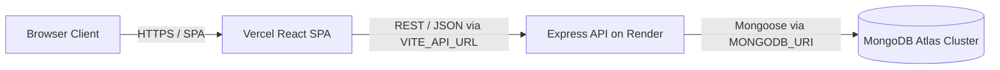

# Voyana — Trip Pe Aana

An intelligent, collaborative travel planning and booking platform connecting travelers with curated journeys, AI-powered itinerary assistance, real-time shared workspaces, and group expense tracking.

## Live Demo

- **Frontend SPA**: [https://voyana-zeta.vercel.app](https://voyana-zeta.vercel.app)
- **Backend Health Endpoint**: [https://voyana-api-4uag.onrender.com/health](https://voyana-api-4uag.onrender.com/health)

> **Note on Render Free Tier**: The backend is hosted on Render's free web service tier. When inactive, the service spins down; initial requests may experience a cold start latency of approximately 30–50 seconds before resuming immediate responses.

## Tech Stack

| Layer | Technology | Version | Purpose |
|---|---|---|---|
| **Frontend** | React | 18.3.1 | Single-Page Application (SPA) component architecture |
| | Vite | 5.4.2 | Development server, module bundler, and build pipeline |
| | TypeScript | 5.5.3 | Static type checking and interface contracts |
| | Tailwind CSS | 3.4.1 | Utility-first responsive styling and design system |
| **Backend** | Express | 4.21.2 | RESTful API routing, middleware, and request validation |
| | Node.js | >= 22.x | Server runtime environment |
| | TypeScript | 5.7.3 | Typed service logic, schemas, and models |
| **Database** | MongoDB Atlas | 7.x compatible | Cloud-managed document database for users, trips, bookings, and ledgers |
| | Mongoose | 8.9.5 | Object Data Modeling (ODM), schemas, and query validation |
| **Hosting** | Vercel | Serverless CDN | Global frontend edge hosting and client-side routing |
| | Render | Cloud Web Service | Backend containerized API hosting with health monitoring |

## Architecture & Integration



- **Frontend to Backend Communication**: The client communicates with the backend via `src/services/apiClient.ts`. The base API endpoint is determined at build time through the `VITE_API_URL` environment variable (falling back to `VITE_AI_SERVICE_URL` or `http://localhost:3001`). Requests are dispatched using standard fetch with JSON payloads, timeout controllers, and an `Authorization: Bearer <token>` header when a user session is active.
- **Backend to Database Connectivity**: The Express application initializes a centralized Mongoose connection in `services/ai-service/src/db/mongo.ts` using `MONGODB_URI`. It connects with connection pooling, automatic index building, reconnect retry logic, and credential masking in server logs.

## Run locally

Use Node.js 22 and npm.

```sh
npm ci
npm ci --prefix services/ai-service
```

Copy `.env.example` to `.env`, and `services/ai-service/.env.example` to `services/ai-service/.env`. Set `MONGODB_URI`, `MONGODB_DB_NAME`, and a private `JWT_SECRET` in the backend file. MongoDB may be local or Atlas.

```sh
npm run dev
```

Open http://localhost:5173. The API listens on http://localhost:3001. `npm run dev:client` and `npm run dev:server` start each process separately.

For the optional demo data, set `SEED_ON_START=true` for one backend start, then set it back to false. Normal startup does not modify seeded data. Use `LLM_PROVIDER=mock` for deterministic AI without an external key, or configure Groq in the backend environment.

## Current features

- Destination discovery and a texture-aligned globe with precise coordinate focus.
- Email/password accounts, Google Identity Services integration, and profile updates. Google login requires a registered Web client ID; see [Google setup](docs/GOOGLE_SIGN_IN.md).
- Destination-locked bookings that create a workspace, itinerary entry and shared expense after confirmation.
- Solo and group journeys, with leader-only group booking and pre-booking chat, tasks and polls.
- Shared expense tracking with member notifications, plus trip-specific budgets and packing.
- AI photo captions and travel journals after trip completion, with a shared 50-photo limit.
- Email invitations with honest pending/sent delivery status; an email sender must be configured.
- Flight, hotel, transport and bundle checkout with INR pricing, a demo OTP confirmation, shared reservations and notifications. No PAN, gateway account or SMS setup is needed. See [demo payments](docs/DEMO_PAYMENTS.md).
- VoyaBot with selected-trip context and local fallback responses.

Bookings, payment methods, tickets, refunds, weather, and currency conversion are demonstrations. OAuth and password-reset delivery need an external provider. Shared documents are local records. Booked-trip access and reservation ownership are enforced by the API. Concurrent editing and production integrations need further work. See the [project flow](docs/PROJECT_FLOW.md) for exact boundaries.

## API Overview

The backend exposes a structured RESTful API under `/api` (and `/ai` for assistant queries). Route implementations reside in `services/ai-service/src/routes/`.

| Method | Path | Purpose | Authentication |
|---|---|---|---|
| **Health** | | | |
| `GET` | `/health` / `/api/health` | Service uptime, dependencies health, and LLM status probe | Public |
| **Authentication & Profiles (`/api/auth`)** | | | |
| `POST` | `/api/auth/signup` | Register new account with email, password, and traveler role | Public |
| `POST` | `/api/auth/login` | Authenticate user credentials and return 7-day JWT session token | Public |
| `GET` | `/api/auth/google/config` | Retrieve Google Web client ID and issue browser challenge nonce | Public (Origin-verified) |
| `POST` | `/api/auth/google` | Verify Google ID token via `google-auth-library` and sign in / register | Public (Challenge-verified) |
| `GET` | `/api/auth/me` | Fetch authenticated user profile and preferences | Required (`Bearer <token>`) |
| `PUT` | `/api/auth/profile` | Update profile attributes (name, avatar, bio, preferences) | Required (`Bearer <token>`) |
| `GET` | `/api/auth/users` | List collaborator directory (administrative directory access) | Required (Admin role) |
| **AI Assistant (`/ai` & `/api/ai`)** | | | |
| `POST` | `/ai/chat` (or `/api/ai/chat`) | Query VoyaBot assistant with optional destination and trip context | Public / Optional |
| **Payments & Checkout (`/api/payments`)** | | | |
| `GET` | `/api/payments/config` | Get active payment gateway provider (`demo` or `razorpay`) and currency | Public |
| `POST` | `/api/payments/orders` | Create validated reservation order and payment intent | Required (`Bearer <token>`) |
| `POST` | `/api/payments/verify` | Verify Razorpay HMAC SHA256 payment signature and capture booking | Required (`Bearer <token>`) |
| `POST` | `/api/payments/demo/confirm` | Confirm reservation in demo mode via simulated 6-digit OTP code | Required (`Bearer <token>`) |
| `POST` | `/api/payments/demo/resend` | Issue fresh 6-digit OTP for pending demo payment intent | Required (`Bearer <token>`) |
| **Trips & Itineraries (`/api/trips`)** | | | |
| `GET` | `/api/trips` | List accessible trips (owned, member of, or public templates) | Required (`Bearer <token>`) |
| `POST` | `/api/trips` | Create a new trip or journey workspace | Required (`Bearer <token>`) |
| `GET` | `/api/trips/:id` | Get trip details, scheduled activities, and member roster | Required (Trip Member) |
| `PUT` | `/api/trips/:id` | Update trip title, destination, dates, or settings | Required (Trip Member) |
| `DELETE` | `/api/trips/:id` | Delete trip workspace and linked records | Required (Trip Owner) |
| `POST` | `/api/trips/:id/activities` | Append an activity item to the daily itinerary | Required (Trip Member) |
| `PUT` | `/api/trips/:id/activities/:activityId` | Update itinerary activity timing, location, or notes | Required (Trip Member) |
| `DELETE` | `/api/trips/:id/activities/:activityId` | Remove activity item from itinerary | Required (Trip Member) |
| `POST` | `/api/trips/:id/members` | Add or invite collaborator to trip | Required (Trip Member) |
| `DELETE` | `/api/trips/:id/members/:memberId` | Remove collaborator from trip | Required (Trip Member) |
| `POST` | `/api/trips/:id/sync` | Trigger synchronization and broadcast updates to members | Required (Trip Member) |
| **Budget & Expenses (`/api/budget`)** | | | |
| `GET` | `/api/budget/:tripId` | Fetch budget overview, category allocations, and expense ledger | Required (Trip Member) |
| `PUT` | `/api/budget/:tripId` | Update overall budget amount or category targets | Required (Trip Member) |
| `POST` | `/api/budget/:tripId/expenses` | Add shared expense with payer, split members, and category | Required (Trip Member) |
| `PATCH` | `/api/budget/:tripId/expenses/:expenseId` | Update title or amount of an expense entry | Required (Trip Member) |
| `DELETE` | `/api/budget/:tripId/expenses/:expenseId` | Remove an expense entry (booking-linked expenses protected) | Required (Trip Member) |
| **Collaboration (`/api/collaboration`)** | | | |
| `GET` | `/api/collaboration/:tripId/chat` | Retrieve group workspace chat history | Required (Trip Member) |
| `POST` | `/api/collaboration/:tripId/chat` | Post message to group workspace chat | Required (Trip Member) |
| `GET` | `/api/collaboration/:tripId/tasks` | List collaborative packing and preparation tasks | Required (Trip Member) |
| `POST` | `/api/collaboration/:tripId/tasks` | Create task with category, due date, and assignee | Required (Trip Member) |
| `PUT` | `/api/collaboration/:tripId/tasks/:taskId` | Update task completion status, assignee, or details | Required (Trip Member) |
| `DELETE` | `/api/collaboration/:tripId/tasks/:taskId` | Delete a collaborative task | Required (Trip Member) |
| `GET` | `/api/collaboration/:tripId/polls` | List decision voting polls for the trip | Required (Trip Member) |
| `POST` | `/api/collaboration/:tripId/polls` | Create new multi-option voting poll | Required (Trip Member) |
| `POST` | `/api/collaboration/:tripId/polls/:pollId/vote` | Cast or update vote on a poll option | Required (Trip Member) |
| `GET` | `/api/collaboration/:tripId/memories` | List travel photos and memories for completed trip | Required (Trip Member) |
| `POST` | `/api/collaboration/:tripId/memories` | Upload photo memory with caption and location | Required (Trip Member) |
| `POST` | `/api/collaboration/:tripId/memories/:memoryId/like` | Toggle like on a memory entry | Required (Trip Member) |
| `DELETE` | `/api/collaboration/:tripId/memories/:memoryId` | Delete a memory entry | Required (Trip Member) |

## External Integrations

- **Groq Cloud Inference**: Powers the intelligent travel assistant (VoyaBot) using high-speed LLM models (`llama-3.3-70b-versatile` for chat planning and `qwen/qwen3.8-27b` for vision/memories) via the official `groq-sdk`. If unconfigured, disabled, or rate-limited, the system falls back seamlessly to `MockLlmClient` for deterministic offline responses.
- **Razorpay (Test Mode)**: Supports payment processing for flights, hotels, ground transport, and package bookings. Operates in Test Mode (`rzp_test_...` key prefix) with server-side order generation, timing-safe cryptographic HMAC SHA-256 signature verification (`crypto.timingSafeEqual`), and automated refund reconciliation upon cancellation. Follow [the setup guide](docs/RAZORPAY_TEST_MODE.md) for configuration.
- **Google Identity Services**: Provides single-click Google authentication. The frontend initiates sign-in using Google's client library; the backend verifies the ID token using `google-auth-library` against registered client IDs and a cryptographically signed challenge nonce bound to the frontend origin.
- **Photon Geocoder**: An open-source geocoding and reverse geocoding API built on OpenStreetMap data (`https://photon.komoot.io`). Powers interactive 3D globe coordinate lookups, place name reverse-geocoding, and location search queries with rate-limiting queues and in-memory caching.

## Environment Variables

Variable names and purposes as defined in `.env.example` templates:

### Frontend (`.env.example`)

| Variable | Purpose |
|---|---|
| `VITE_API_URL` | Base URL of the backend REST API endpoint |
| `VITE_AI_SERVICE_URL` | Fallback backend service URL for AI assistant requests |
| `VITE_SUPABASE_URL` | (Optional) Legacy Supabase URL for optional media storage migrations |
| `VITE_SUPABASE_ANON_KEY` | (Optional) Legacy Supabase anonymous key for optional storage migrations |

### Backend (`services/ai-service/.env.example`)

| Variable | Purpose |
|---|---|
| `PORT` | Local network port for the Express server to listen on |
| `NODE_ENV` | Application runtime environment (`development`, `test`, or `production`) |
| `LLM_PROVIDER` | AI provider selection (`groq` for live LLM inference or `mock` for deterministic fallback) |
| `GROQ_API_KEY` | API authentication key for Groq Cloud services |
| `GROQ_MODEL` | Groq chat model identifier |
| `MONGODB_URI` | MongoDB connection URI string (local or MongoDB Atlas connection string) |
| `MONGODB_DB_NAME` | Target MongoDB database name |
| `JWT_SECRET` | Secret key for signing and verifying JSON Web Tokens |
| `SEED_ON_START` | Boolean toggle to populate sample records on initial backend boot |
| `GOOGLE_CLIENT_ID` | Google OAuth 2.0 Web Client ID for Google Identity Services |
| `FRONTEND_ORIGINS` | Comma-separated list of allowed frontend origins for CORS and OAuth origin binding |
| `PAYMENT_PROVIDER` | Checkout payment mode (`demo` for screen OTP simulation or `razorpay` for Test Mode) |
| `RAZORPAY_KEY_ID` | Razorpay Test Mode Key ID |
| `RAZORPAY_KEY_SECRET` | Razorpay Test Mode Key Secret used for HMAC signature verification |
| `RESEND_API_KEY` | (Optional) API key for the Resend service to send group trip email invitations |
| `INVITATION_FROM` | (Optional) Verified sender email address used for outgoing invitation emails |
| `PUBLIC_APP_URL` | Public frontend URL included in invitation links |
| `GROQ_VISION_MODEL` | (Optional) Vision model identifier used for photo-aware memory descriptions |
| `GEOCODER_URL` | Base URL for the Photon-compatible place search and reverse geocoding service |

## Check the project

```sh
npm run typecheck
npm run build
npm run build --prefix services/ai-service
npm test --prefix services/ai-service
npm run test:smoke
npm run test:ui
npm run lint
```

Backend integration tests require MongoDB and use the separate `voyana_test` database. Database-free backend tests can run with:

```sh
npm test --prefix services/ai-service -- --testPathIgnorePatterns=mongodb-api
```

Browser tests require both development servers running and Edge on Windows. They create isolated test accounts and do not require seeded login credentials. On other systems install Playwright Chromium using `npx playwright install chromium`. Set `VOYANA_URL` for a different frontend URL and `PLAYWRIGHT_CHANNEL` to select another installed browser.

`test:smoke` exercises flight, hotel, transport and bundle reservations plus trip activities, shared expenses, packing and cancellation. `test:ui` checks globe geography, the before/after booking interface, actual flight checkout, destination switching, mobile overflow and API role restrictions. Test records may remain as audit history; use a development database with test data.

For isolated browser tests, start the backend with `NODE_ENV=test`, `PORT=3101`, and `SEED_ON_START=false`, and start Vite on port 5174 with `VITE_API_URL=http://127.0.0.1:3101/api`. Set `VOYANA_URL=http://127.0.0.1:5174` when running browser checks. The API tests automatically use `voyana_test`.

GitHub CI builds both applications and runs the full backend regression test suite against a containerized MongoDB service. See the [verification report](docs/VERIFICATION.md) for current results and remaining warnings.

## CI/CD & Deployment

- **Continuous Integration (`.github/workflows/ci.yml`)**: On every `push` and `pull_request` to the repository, GitHub Actions runs an automated workflow on `ubuntu-latest`:
  1. Starts a containerized MongoDB service (`mongo:7` on port 27017) with automated `mongosh` health check pings.
  2. Sets up Node.js 22 with npm dependency caching.
  3. Cleanly installs root and backend dependencies using `npm ci`.
  4. Runs frontend static type checking via `npm run typecheck`.
  5. Compiles production builds for both the Vite frontend (`npm run build`) and Express backend (`npm run build --prefix services/ai-service`).
  6. Executes backend regression test suites (`npm test --prefix services/ai-service`) with `NODE_ENV=test`, `LLM_PROVIDER=mock`, `PAYMENT_PROVIDER=demo`, and the containerized database `mongodb://127.0.0.1:27017/voyana_test`.
- **Continuous Deployment**:
  - **Frontend (Vercel)**: Automatically builds and deploys the React SPA on every push to the `main` branch.
  - **Backend (Render)**: Automatically builds and rolls out the Express web service on every push to the `main` branch.

## Known Limitations

- **Security Gaps**:
  - **CORS Allowlist**: The backend currently mounts open `cors()` middleware across general routes; strict origin matching is enforced on Google OAuth challenge endpoints rather than globally.
  - **Security Headers (Helmet)**: HTTP security headers via `helmet` are not currently configured on the Express app.
  - **Rate Limiting**: Global API rate-limiting middleware (`express-rate-limit`) is not attached across all routes (only bounded in-memory rate controls on geocoding lookups and Google auth challenges).
  - **Dependency Advisories**: Routine low-severity transitive development dependency advisories from build tooling.
  - **JWT Secret**: Outside of automated test suites (`NODE_ENV=test` where a dedicated test secret is used), there is no hardcoded fallback; a valid `JWT_SECRET` must be set in the backend environment or startup fails fast.
- **Demonstration Features**:
  - Flight, hotel, and transport bookings, inventory schedules, boarding passes/vouchers, refund processing, and demo OTP codes are educational simulations; no real-world airline GDS, hotel PMS, or financial clearinghouse is contacted.
  - Weather forecasts and currency exchange rates use static sample data models.
  - Real email invitations require an active Resend API key and verified domain; in demo mode, invitations are tracked in database state as pending/simulated.

## Structure

```text
src/App.tsx                Page composition and one active service modal
src/components/            Feature screens
src/services/              Domain logic, one API client, shared planning context
src/context/               Authentication provider
services/ai-service/src/    Express API, validation, Mongoose models, AI providers
scripts/                   Combined development launcher and browser checks
docs/PROJECT_FLOW.md        Current user and data flow
docs/VERIFICATION.md        Tests, changes, and remaining work
supabase/                  Legacy optional schema migrations
```

Environment files, dependencies, builds, and local verification reports are excluded from Git. Keep provider keys in environment files. Existing project authorship and educational-use terms are retained.

For Razorpay Test Mode, follow [the setup guide](docs/RAZORPAY_TEST_MODE.md). The local configuration selects Razorpay; test API keys are still required.

See [solo and group trip flow](docs/SOLO_AND_GROUP_TRIPS.md) for roles, email setup, photo storage and AI generation.

## Team

| Name | Student ID |
|---|---|
| Diya Shah | 202512025 |
| Tirth Gandhi | 202512038 |
| Nigam Sanghvi | 202512031 |
| Bhavika Sainani | 202512053 |
| Bhavika Mulani | 202512079 |
| Megha Lalwani | 202512054 |
| Jagrat Kumar | 202512119 |
| Manav Vyas | 202512062 |
