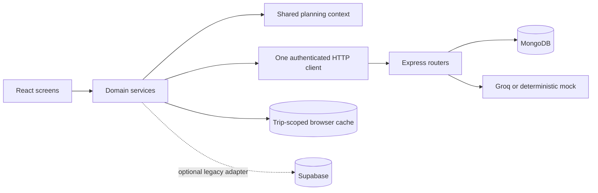

# Voyana architecture

The current implementation is described in [PROJECT_FLOW.md](docs/PROJECT_FLOW.md).

`App.tsx` manages one active service modal. Feature dialogs load on demand. `planningContext.ts` identifies the selected destination or saved trip. `tripStore.ts` supplies budget and packing with a per-trip cache, serialized writes, and retry before fetching newer server state. The reservation ledger is shared by all booking entry points.

The main path is React -> domain service -> `apiClient.ts` -> Express -> MongoDB. The optional Supabase client is constructed once in `supabaseClient.ts`; older domain paths are retained for compatibility and have not been revalidated against a live Supabase project.

This is a demonstration architecture. Production vendor booking/payment integration, comprehensive resource authorization, and conflict-safe concurrent editing are not implemented. Historical design documents should not be treated as proof that those features exist.
