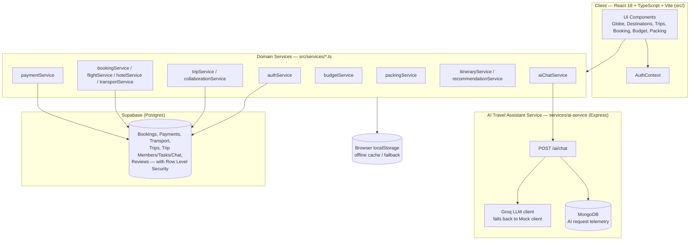
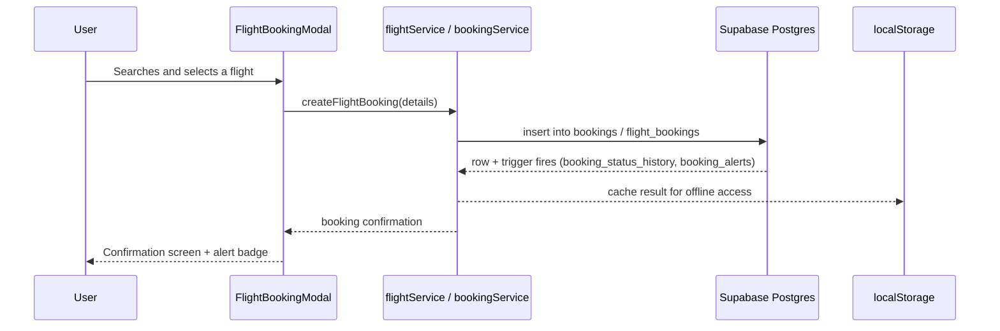

# Voyana — Architecture Overview

> This is a simplified, repository-grounded companion to the detailed design docs in
> [`docs/system_architecture.md`](docs/system_architecture.md) (VPM-13) and
> [`docs/diagrams/er-diagram.md`](docs/diagrams/er-diagram.md) (VPM-26). Read those for full
> detail; this file is the quick-start map. Referenced in the
> [Project Documentation PDF](docs/) under "Architecture".

## 1. What Voyana Is

Voyana is a collaborative, AI-assisted travel planning and booking web application: users
explore destinations on a 3D globe, plan multi-day itineraries, split budgets, build packing
lists, and book flights/hotels/transport with a group of trip collaborators.

## 2. High-Level Component Diagram

## 3. Major Components and Responsibilities

| Component | Responsibility | Source |
|---|---|---|
| **UI Layer** | Globe/destination exploration, trip workspace, booking modals, budget/packing modals, auth pages | [`src/components/`](src/components/), [`src/pages/`](src/pages/) |
| **AuthContext** | Holds the current Supabase session, exposes login/logout state | [`src/context/AuthContext.tsx`](src/context/AuthContext.tsx) |
| **Domain Services** | All business logic and data access (no separate API layer); each file owns one domain | [`src/services/`](src/services/) |
| **AI Travel Assistant Service** | Standalone Express microservice that proxies chat requests to Groq (or a deterministic mock), validates with Zod, logs telemetry | [`services/ai-service/`](services/ai-service/) |
| **Supabase (Postgres)** | System of record for bookings, payments, transport, trips/collaboration, and reviews, with Row Level Security | [`supabase/migrations/`](supabase/migrations/) |
| **MongoDB** | Separate store, used only by the AI service for request telemetry — not shared with the Supabase data | [`services/ai-service/src/db/mongo.ts`](services/ai-service/src/db/mongo.ts) |
| **Browser localStorage** | Offline-first cache and fallback when a Supabase/AI call fails | used throughout `src/services/*.ts` |

## 4. How Components Communicate

- The UI calls domain services directly (no REST layer between the React app and `src/services/`); each service either calls the Supabase client (`@supabase/supabase-js`) or reads/writes `localStorage`.
- The chat UI (`ChatAssistantModal.tsx`) calls `aiChatService.ts`, which calls the separate `ai-service` Express backend over HTTP (`POST /ai/chat`); that backend talks to Groq or a local mock client and logs each request to MongoDB.
- Supabase Postgres triggers (e.g. `trg_booking_status_change`) generate alert rows server-side, which the client polls/subscribes to for the notifications panel.

## 5. Data Flow, Input to Output (example: booking a flight)

If the Supabase call fails, the service falls back to the cached/mock data in `localStorage`
so the UI still responds (see Section 7 of the project report for where this fallback is
silent rather than surfaced to the user).

## 6. Key Technologies and Integrations

- **Frontend**: React 18, TypeScript, Vite, Tailwind CSS, `lucide-react` icons
- **3D Globe**: Three.js, rendering destination markers and routes on a textured Earth (`src/components/Globe/`)
- **Backend-as-a-Service**: Supabase (Postgres + Auth + Row Level Security + Realtime)
- **AI microservice**: Node.js + Express + Groq SDK (with a mock LLM client for offline development) + MongoDB for telemetry
- **Planned but not yet implemented in code**: Stripe payment gateway integration (currently a simulated/mock payment flow — see `src/services/paymentService.ts`), and Supabase-backed persistence for budget, packing, itinerary, and AI chat history (currently `localStorage`-only; see [`docs/diagrams/er-diagram.md`](docs/diagrams/er-diagram.md) for the conceptual schema that has not yet been migrated)

## 7. Where to Read More

- [`docs/system_architecture.md`](docs/system_architecture.md) — detailed SCA (VPM-13)
- [`docs/architecture_review.md`](docs/architecture_review.md) — architecture decision review and sign-off (VPM-25)
- [`docs/diagrams/er-diagram.md`](docs/diagrams/er-diagram.md) — conceptual entity-relationship diagrams (VPM-26)
- [`docs/Readme_Files/db-review.md`](docs/Readme_Files/db-review.md) — booking schema deep-dive (VPM-28)
- [`docs/Readme_Files/findings.md`](docs/Readme_Files/findings.md) — BaaS and third-party provider evaluation (VPM-22)
